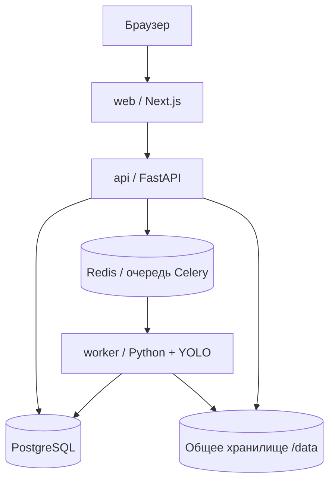

# Архитектура LineSight AI

Проект разделён на независимые компоненты: веб-интерфейс, HTTP API, процесс обработки видео, очередь и PostgreSQL. Сервисы запускаются через Docker Compose.



| Компонент | Ответственность |
| --- | --- |
| `frontend/` | Интерфейс, запросы к API |
| `backend/` | REST API, доступ к данным и файлам, постановка задач в очередь |
| `ml/` | Обработка видео, инференс, обучение, синтетика |
| `postgres` | Метаданные, задания, результаты обработки |
| `redis` | Очередь задач Celery |
| `media_data` | Видео, кадры, отчёты и веса (`/data`) |

Контейнеры `api` и `worker` используют общий Docker volume `/data`. В PostgreSQL лежат идентификаторы и **относительные** пути к файлам, а не сами видео. Доступ к БД и хранилищу есть только у серверных компонентов.

PostgreSQL и Redis не публикуются на хост; веб-интерфейс и API доступны только через `127.0.0.1`. Для размещения вне локальной машины нужно отдельно настроить TLS, управление доступом и ограничения загрузки файлов.

## Раскладка `/data`

```
/data
  inspections/<id>/video.mp4
  inspections/<id>/frames/<имя>.jpg
  inspections/<id>/report.pdf
  weights/best.pt
  demo/                      # публичные и синтетические видео, ready_inspection
```
