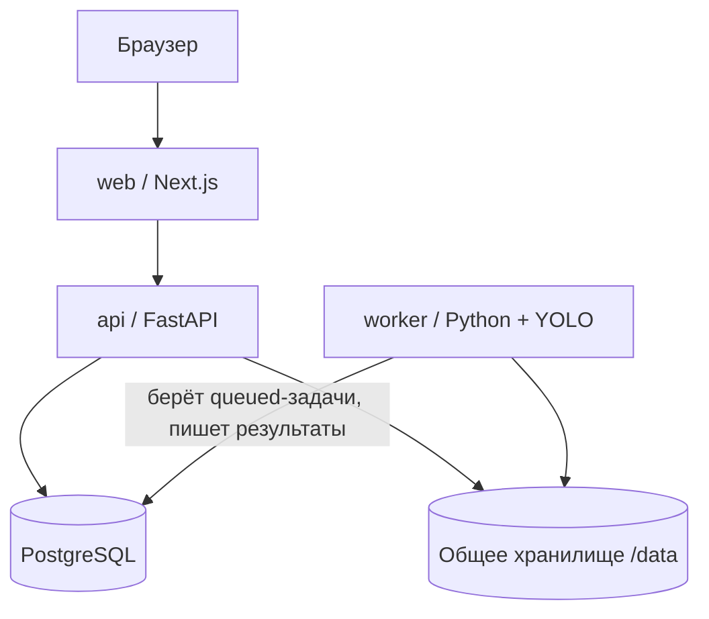

# Архитектура LineSight AI

Проект разделён на независимые компоненты: веб-интерфейс, HTTP API, процесс обработки видео и PostgreSQL. Сервисы запускаются через Docker Compose.



| Компонент | Ответственность |
| --- | --- |
| `frontend/` | Интерфейс, запросы к API |
| `backend/` | REST API, доступ к данным и файлам, постановка задач в очередь |
| `ml/` | Обработка видео, инференс, обучение, синтетика |
| `postgres` | Метаданные, задания, результаты обработки |
| `media_data` | Видео, кадры, отчёты и веса (`/data`) |

Контейнеры `api` и `worker` используют общий Docker volume `/data`. В PostgreSQL лежат идентификаторы и **относительные** пути к файлам, а не сами видео. Доступ к БД и хранилищу есть только у серверных компонентов.

PostgreSQL не публикуется на хост; веб-интерфейс и API доступны только через `127.0.0.1`. Для размещения вне локальной машины нужно отдельно настроить TLS, управление доступом и ограничения загрузки файлов.

## Очередь без Redis

Очередью служит таблица `inspections`: API создаёт запись со статусом `queued`, воркер раз в `POLL_INTERVAL_SEC` секунд атомарно забирает самую старую (`UPDATE … WHERE status='queued'`, в Postgres с `FOR UPDATE SKIP LOCKED`) и переводит её в `processing`. Два воркера не возьмут одну задачу. Лимит времени задаётся `TASK_SOFT_TIME_LIMIT_SEC`; при превышении задача получает `failed` с кодом `E_TIMEOUT`. При старте воркер помечает «зависшие» `processing`-задачи как `failed/E_TIMEOUT`.

Это отклонение от плана MVP (там Celery + Redis): решение принято владельцем проекта 3 ноября.

## Раскладка `/data`

```
/data
  inspections/<id>/video.mp4
  inspections/<id>/frames/<имя>.jpg
  inspections/<id>/report.pdf
  weights/best.pt
  demo/                      # публичные и синтетические видео, ready_inspection
```
