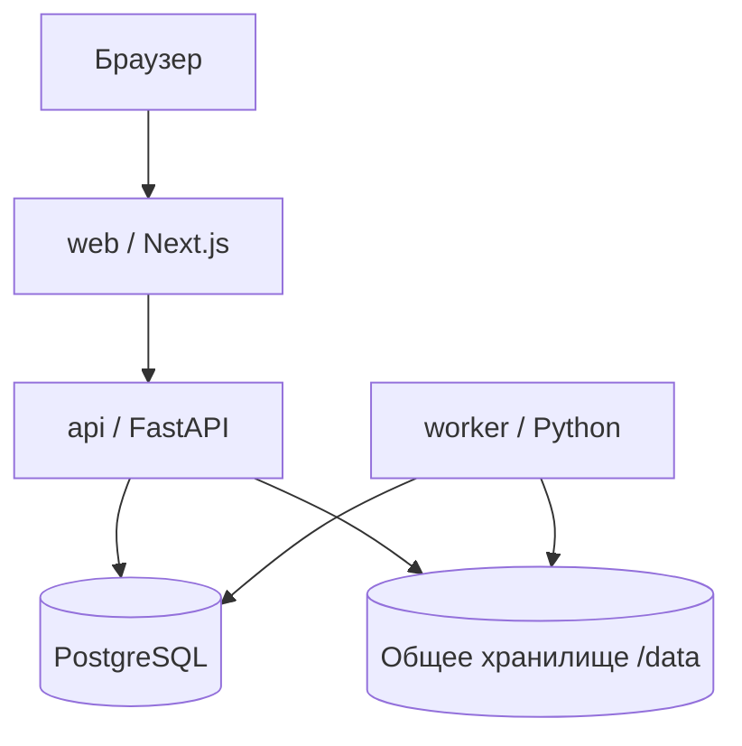
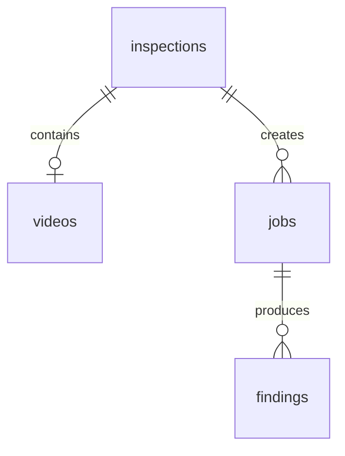

## Архитектура LineSight AI

Проект разделён на независимые компоненты: веб-интерфейс, HTTP API, процесс обработки видео и PostgreSQL. Сервисы запускаются через Docker Compose.



| Компонент | Ответственность |
| --- | --- |
| `frontend/` | Интерфейс, запросы к API |
| `backend/` | REST API, доступ к данным и файлам |
| `ml/` | Обработка видео, инференс |
| `postgres` | Метаданные, задания, результаты обработки |
| `media_data` | Видео, кадры и другие бинарные файлы |

Контейнеры `api` и `worker` используют общий Docker volume `/data`. Записи в PostgreSQL содержат идентификаторы и пути к файлам, а не сами видео. Доступ к БД и хранилищу осуществляется только из серверных компонентов.

PostgreSQL не публикуется на хост; веб-интерфейс и API доступны только через `127.0.0.1`. Для размещения вне локальной машины необходимо отдельно настроить TLS, управление доступом и ограничения загрузки файлов.

## База данных PostgreSQL

Для хранения метаданных и результатов обработки используется PostgreSQL. Взаимодействие с БД реализовано через SQLAlchemy 2.0, управление схемой — через Alembic.

Основные компоненты слоя данных:

| Файл | Назначение |
| --- | --- |
| `backend/app/database.py` | Создание SQLAlchemy Engine и сессий |
| `backend/app/models.py` | ORM-модели таблиц |
| `backend/app/repositories.py` | Операции создания записей и получения заданий |
| `backend/migrations/` | Версионированные миграции Alembic |
| `backend/alembic.ini` | Конфигурация миграций |

### Схема данных

На текущем этапе реализованы четыре основные таблицы:

| Таблица | Назначение |
| --- | --- |
| `inspections` | Инспекции загруженных видеоматериалов |
| `videos` | Метаданные MP4 и ключи файлов в хранилище |
| `jobs` | Задания на обработку и их состояния |
| `findings` | Результаты анализа видео |

Связи между сущностями:



- `inspections` — идентификатор UUID, название и время создания.
- `videos` — идентификатор, ссылка на инспекцию, имя файла, ключ хранения, размер, продолжительность, FPS и разрешение.
- `jobs` — идентификатор, ссылка на инспекцию, статус, прогресс, количество попыток, lease token, heartbeat, название и версия модели, временные метки и сообщение об ошибке.
- `findings` — идентификатор, ссылка на задание, категория обнаружения, уверенность модели, таймкод, номер кадра, bounding box и ключ изображения.

Первичные и внешние ключи обеспечивают целостность связей. Для статусов и числовых значений определены ограничения, для поиска заданий и находок — индексы.

Одна инспекция может иметь несколько заданий обработки, что позволяет повторно анализировать видео разными моделями. На текущем этапе одной инспекции соответствует не более одного видео.

### Хранение результатов ML

Схема данных не зависит от конкретного датасета или архитектуры нейросети.

Результаты инференса сохраняются в таблице `findings`. Поле `category` содержит строковый идентификатор класса, `confidence` — оценку уверенности в диапазоне от 0 до 1, `timecode_s` — положение в видео.

Поле `bbox` использует PostgreSQL JSONB для хранения координат объекта. Предполагаемый контракт — нормализованные координаты `[x1, y1, x2, y2]`. Проверка их структуры и допустимых значений должна выполняться на уровне приложения.

Изображения и видео хранятся отдельно в `/data`, а PostgreSQL содержит только ссылки на соответствующие файлы.

### Управление заданиями

Таблица `jobs` поддерживает четыре состояния:

`queued → processing → done | failed`

Для получения следующего задания реализован механизм `SELECT ... FOR UPDATE SKIP LOCKED`. Он позволяет нескольким процессам выбирать задания без одновременного захвата одной строки при корректном управлении транзакциями.

Реализованы базовые операции создания инспекции вместе с видео и заданием, а также получения следующего задания из очереди.

Для управления заданиями реализованы операции захвата, heartbeat, завершения, регистрации ошибки и восстановления после сбоя.

Worker получает задания через общий Repository на SQLAlchemy. Захват выполняется с использованием `FOR UPDATE SKIP LOCKED`, после чего транзакция фиксируется до запуска обработки. При каждой попытке назначается новый `lease_token`, который проверяется при обновлении состояния задания.

Во время обработки worker периодически обновляет `heartbeat_at` через отдельную сессию PostgreSQL. Зависшие задания могут быть повторно поставлены в очередь с ограничением количества попыток.

ML-процессор подключается как отдельный Python-модуль через `JOB_PROCESSOR`. Его интерфейс включает название модели, версию, признак готовности и функцию `process_video()`.

Результаты проходят проверку Pydantic и записываются в таблицу `findings` в одной транзакции с переводом задания в состояние `done`.

При отсутствии настроенной ML-модели worker не забирает задания. Реальный инференс подключается отдельно.

### Миграции

Схема PostgreSQL управляется Alembic и не создаётся автоматически при запуске FastAPI.

Первая миграция `0001_initial` создаёт таблицы, внешние ключи, ограничения и индексы.
Миграция `0002_job_runtime` расширяет таблицу `jobs` полями управления обработкой и метаданными модели, а таблицу `findings` — номером видеокадра. Миграции сохраняют существующие записи.

Миграции выполняются отдельно:

```bash
docker compose --env-file .env \
  -f infra/compose.yaml \
  run --rm api alembic upgrade head
```

Текущая версия схемы хранится в служебной таблице `alembic_version`.

## HTTP API

Backend использует FastAPI. Реализованы следующие эндпоинты:

| Метод | Путь | Назначение |
| --- | --- | --- |
| `GET` | `/health` | Проверка API, PostgreSQL и хранилища |
| `POST` | `/inspections` | Загрузка MP4, создание инспекции и задания |
| `GET` | `/inspections` | Список инспекций |
| `GET` | `/inspections/{id}` | Данные инспекции, видео и заданий |
| `GET` | `/inspections/{id}/video` | Получение исходного видео |
| `GET` | `/jobs/{id}` | Состояние задания |
| `GET` | `/inspections/{id}/findings` | Результаты анализа |

Загрузка MP4 выполняется потоковым чтением с ограничением размера файла. Проверяются формат контейнера и метаданные видео через `ffprobe`.

После успешной загрузки файл сохраняется под UUID-именем, а в PostgreSQL создаются связанные записи `Inspection`, `Video` и `Job`.

Для передачи данных клиенту используются Pydantic-схемы. Внутренние ключи файлового хранилища не включаются в публичное описание видео.

## Текущее состояние

Локальная инфраструктура включает Next.js, FastAPI, PostgreSQL и отдельный Python worker. Сервисы развёртываются через Docker Compose.

Реализованы миграции `0001_initial` и `0002_job_runtime`, SQLAlchemy-модели, Repository для управления заданиями и универсальные Pydantic-схемы результатов.

FastAPI предоставляет загрузку MP4, получение инспекций, видеоматериалов, статусов обработки и сохранённых находок.

Worker интегрирован с PostgreSQL и общим файловым хранилищем. Реализованы получение задания, подтверждение активности, фиксация результата или ошибки и восстановление зависших заданий.

Подключение конкретной ML-модели выполняется через отдельный модуль-процессор. В базовой конфигурации инференс отключён, задания остаются в состоянии `queued`.

Обучение модели, обработка кадров и определение категорий объектов реализуются ML-командой независимо от backend и базы данных.
