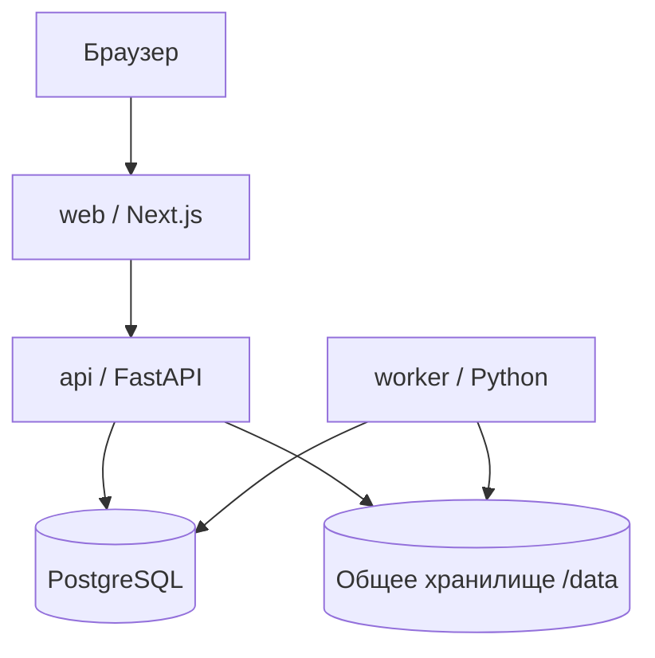

# Архитектура LineSight AI

Проект разделён на независимые компоненты: веб-интерфейс, HTTP API, процесс обработки видео и PostgreSQL. Сервисы запускаются через Docker Compose.

| Компонент | Ответственность |
| --- | --- |
| `frontend/` | Интерфейс, запросы к API |
| `backend/` | REST API, доступ к данным и файлам |
| `ml/` | Обработка видео, инференс |
| `postgres` | Метаданные, задания, результаты обработки |
| `media_data` | Видео, кадры и другие бинарные файлы |

Контейнеры `api` и `worker` используют общий Docker volume `/data`. Записи в PostgreSQL должны содержать идентификаторы и пути к файлам, а не сами видео. Доступ к БД и хранилищу осуществляется только из серверных компонентов.

Текущее API предоставляет `/health`, frontend предоставляет `/api/health`, а worker проверяет соединение с БД и доступность хранилища. Таблицы приложения, задания, загрузка файлов и CV-инференс реализуются в соответствующих модулях проекта.

PostgreSQL не публикуется на хост; веб-интерфейс и API доступны только через `127.0.0.1`. Для размещения вне локальной машины необходимо отдельно настроить TLS, управление доступом и ограничения загрузки файлов.
